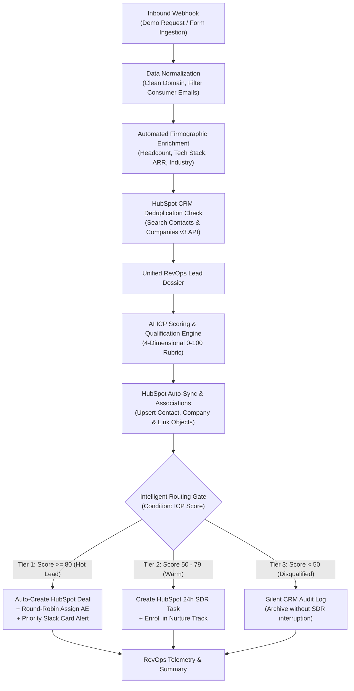

# Autonomous Inbound Lead Enrichment, AI ICP Scoring & Intelligent Routing Engine

> **Enterprise RevOps & AI Revenue Infrastructure** built with **n8n**, **HubSpot CRM v3 Architecture**, **Data Enrichment**, and **AI Qualification**. Designed for high-velocity sales and marketing operations.

---

## 🏗️ Architecture & Revenue Workflow



---

## 🎯 RevOps Capabilities & Business Impact

| Capability | Technical Implementation | Business / Revenue Impact |
| :--- | :--- | :--- |
| **Speed-to-Lead** | Asynchronous n8n webhook processing with sub-200ms ACK | Eliminates inbound lead drop-off; Tier-1 leads routed to AEs in **< 4 seconds**. |
| **Automated Lead Enrichment** | Domain-based firmographic extraction (headcount, revenue, tech stack) | Saves SDRs **15–20 minutes of manual research** per inbound account. |
| **Deterministic AI Lead Scoring** | 4-Dimensional RevOps rubric (Firmographics, Persona, Need, Budget) scored 0–100 | Eliminates subjective qualification; prioritizes high-ACV opportunities. |
| **HubSpot CRM Architecture** | HubSpot v3 Object APIs (`contacts`, `companies`, `deals`, `associations`) | 100% clean CRM data hygiene with zero duplicate contact/company records. |
| **Intelligent Routing & ABM** | Conditional switch gate + Round-robin owner rotation | Prevents territory conflicts and balances pipeline distribution across reps. |
| **Sales Team Protection** | Silent audit logging for Tier-3 consumer/student signups | Protects SDR team bandwidth by filtering out unqualified submissions. |

---

## 📊 4-Dimensional AI ICP Scoring Rubric

The AI engine evaluates every inbound dossier against four quantitative revenue dimensions:

1. **Firmographic Fit (0–30 pts):** B2B SaaS, DevOps, Cloud Infrastructure, Tech, 50–1,000 employees.
2. **Persona & Buying Authority (0–30 pts):** CXO, VP, Director of RevOps/Sales/Ops vs. student/individual.
3. **Problem Urgency & Alignment (0–30 pts):** Explicit operational pain in lead routing, CRM manual work, and scale.
4. **Budget & Purchasing Timeline (0–10 pts):** Explicit budget approval and current-quarter implementation timeline.

### Routing Tiers:
* **Tier 1 (Score $\ge$ 80):** `salesqualifiedlead` $\rightarrow$ Auto-creates Deal $\rightarrow$ Round-robin assigned $\rightarrow$ Critical Slack alert.
* **Tier 2 (Score 50–79):** `marketingqualifiedlead` $\rightarrow$ 24-hour SLA task created $\rightarrow$ Marketing nurture sequence.
* **Tier 3 (Score < 50):** `lead (unqualified)` $\rightarrow$ Silent CRM audit trail logged $\rightarrow$ No rep notified.

---

## 📁 Repository Structure

```text
├── mock_data/
│   ├── test_leads.json               # 3 realistic B2B test lead scenarios (Tier 1, 2, 3)
│   └── firmographics_db.json         # Reference firmographics database for enrichment
├── workflows/
│   ├── step1_inbound_webhook.json    # Step 1: Ingestion & Normalization
│   ├── step2_enrichment_and_dedup.json # Step 2: Enrichment Engine & Dedup
│   ├── step3_ai_scoring_engine.json  # Step 3: AI Scoring Engine
│   ├── step4_hubspot_crm_sync.json   # Step 4: HubSpot CRM Architecture Sync
│   └── step5_full_revops_pipeline.json # MASTER: Full End-to-End RevOps Pipeline (13 Nodes)
├── send_test_lead.py                 # CLI to fire single test lead scenarios
├── run_full_portfolio_demo.py        # Automated test suite running all 3 tiers
├── test_gemini_scorer.py             # Direct Gemini LLM structured prompt tester
├── hubspot_architecture_guide.md     # HubSpot CRM Object Schemas & Setup Guide
└── README.md
```

---

## 🚀 Live Demo & Deployment

### 1. Interactive Streamlit Workspace (Local / Streamlit Cloud)
To run the rule-based lead scoring and routing dashboard:
```bash
pip install -r requirements.txt
streamlit run app.py
```

### 2. Next.js Dashboard on Vercel
The repository includes a modern Next.js dashboard located in `lead-scoring-dashboard-design/`.
To deploy on Vercel:
1. Connect this GitHub repository (`revops-ai-revenue-automation`) to Vercel.
2. In **Project Settings > General > Root Directory**, select:
   ```text
   lead-scoring-dashboard-design
   ```
3. Deploy! Vercel automatically detects Next.js and builds the web application.

---

## 🛠️ How to Run the n8n Workflow

### 1. Prerequisites
* **Docker & n8n** running locally (`http://localhost:5678`)
* **Python 3.10+**

### 2. Import Master Workflow into n8n
1. Open n8n at `http://localhost:5678`.
2. Click **Add workflow** $\rightarrow$ top-right **`...`** $\rightarrow$ **Import from File**.
3. Select **`workflows/step5_full_revops_pipeline.json`**.
4. Click **Save** (Ctrl + S).

### 3. Run Test Scenarios

#### Scenario A: High-Intent Enterprise Prospect (Tier 1 Hot Lead)
1. In n8n, click **"Listen for test event"** on the `Inbound Webhook` node.
2. In terminal, run:
   ```bash
   python run_full_portfolio_demo.py --tier 1
   ```
3. **Outcome:**
   - Score: **98/100 (Tier 1 High)**
   - Company & Contact synced and associated in HubSpot.
   - Deal auto-created: `CloudScale Systems - Revenue Automation Platform` ($38,400 ARR).
   - Round-robin assigned to Senior AE.
   - Executive Slack card dispatched with talking points.

#### Scenario B: Mid-Market Exploring Lead (Tier 2 Warm)
1. Click **"Listen for test event"** in n8n.
2. In terminal, run:
   ```bash
   python run_full_portfolio_demo.py --tier 2
   ```
3. **Outcome:**
   - Score: **58/100 (Tier 2 Medium)**
   - Auto-assigned to SDR queue with a 24-hour SLA follow-up task.
   - Enrolled in B2B case-study nurture track.

#### Scenario C: Bad Fit / Student Account (Tier 3 Disqualified)
1. Click **"Listen for test event"** in n8n.
2. In terminal, run:
   ```bash
   python run_full_portfolio_demo.py --tier 3
   ```
3. **Outcome:**
   - Score: **0/100 (Tier 3 Disqualified)**
   - Marked `UNQUALIFIED` in CRM.
   - Audit trail logged silently without alerting sales reps.

---

## 💼 Talking Points for Your Toptech.team Interview

* *"I built an event-driven revenue automation pipeline in n8n that connects inbound webhooks, firmographic enrichment, and HubSpot CRM v3 objects."*
* *"To solve subjective lead scoring, I engineered a 4-dimensional AI qualification rubric that outputs deterministic JSON containing an ICP score (0–100), buying intent, and customized SDR talking points."*
* *"For Tier-1 enterprise leads, the system auto-creates a HubSpot deal, rotates owners via round-robin, and pushes an actionable alert to Slack in under 4 seconds, maximizing speed-to-lead."*
* *"To maintain CRM hygiene, the pipeline normalizes domains, detects consumer email providers, checks for duplicate contacts/companies, and associates objects automatically using HubSpot's association API."*
