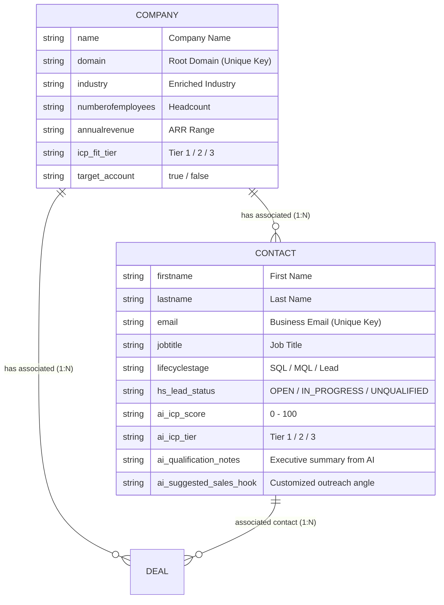

# HubSpot CRM Architecture & RevOps Schema Guide

This guide explains the exact HubSpot CRM architecture used in this pipeline.

---

## 1. HubSpot Objects & Associations

Our pipeline operates across two core standard objects (and automatically creates Deals for Tier-1 in Step 5):

---

## 2. Custom Properties Required in HubSpot

If connecting to a live HubSpot account, these custom properties are created under **Settings $\rightarrow$ Properties**:

| Object | Field Name | Internal Name | Type | Options / Purpose |
| :--- | :--- | :--- | :--- | :--- |
| **Contact** | AI ICP Score | `ai_icp_score` | Number / String | 0 to 100 calculated score |
| **Contact** | AI ICP Tier | `ai_icp_tier` | Dropdown / Single-line | `Tier 1 (High)`, `Tier 2 (Medium)`, `Tier 3 (Disqualified)` |
| **Contact** | AI Qualification Notes | `ai_qualification_notes` | Multi-line text | 2-sentence rationale explaining the score |
| **Contact** | AI Sales Hook | `ai_suggested_sales_hook` | Single-line text | Talking points for SDR outreach |
| **Company** | ICP Fit Tier | `icp_fit_tier` | Dropdown | `Tier 1 (High)`, `Tier 2 (Medium)`, `Tier 3 (Disqualified)` |
| **Company** | Target Account | `target_account` | Boolean (Single checkbox) | Marked `true` for Tier 1 enterprise accounts |

---

## 3. How to Connect a Free HubSpot Account (Optional 3-Minute Setup)

1. Sign up for a free developer sandbox or free CRM: [https://app.hubspot.com/signup](https://app.hubspot.com/signup)
2. In HubSpot, click the **Settings (Gear Icon)** top right $\rightarrow$ **Integrations** $\rightarrow$ **Private Apps**.
3. Click **Create a private app**:
   - Name: `n8n RevOps Engine`
   - Scopes tab $\rightarrow$ check:
     - `crm.objects.contacts.read` & `crm.objects.contacts.write`
     - `crm.objects.companies.read` & `crm.objects.companies.write`
     - `crm.objects.deals.read` & `crm.objects.deals.write`
4. Click **Create app** $\rightarrow$ **Copy Token** (`pat-na1-...`).
5. In n8n, this token can be stored as an Environment Variable `HUBSPOT_ACCESS_TOKEN` or pasted directly into n8n's HubSpot credential.
